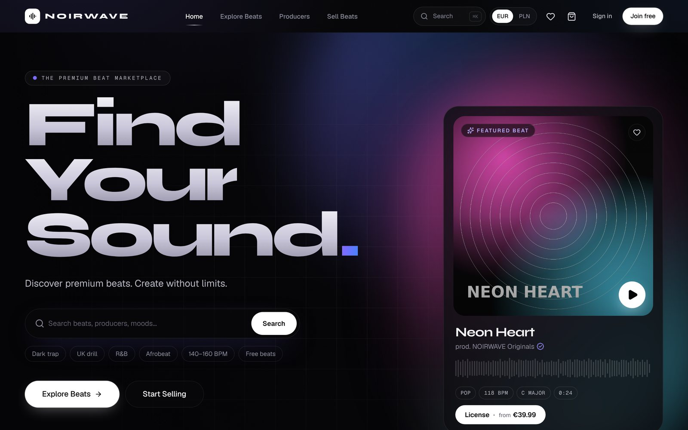
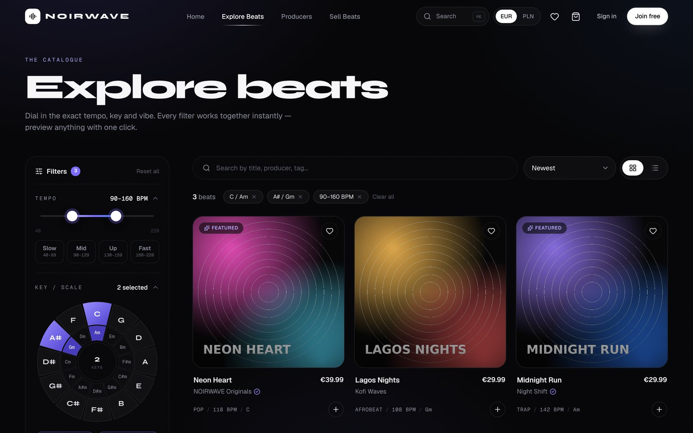
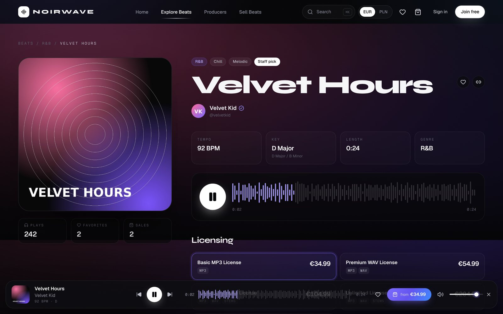
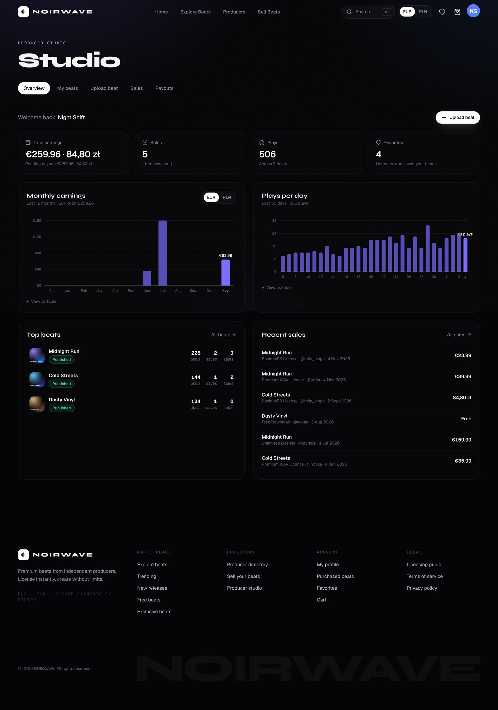
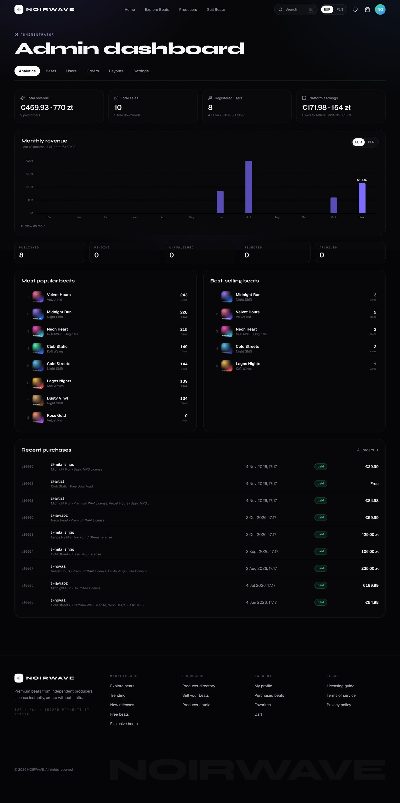

# VBEATS — premium beat marketplace

A full-stack marketplace where producers upload, showcase and sell beats, and artists preview, license and download them.
Built with **Next.js 16 (App Router, Cache Components)**, **Supabase** (Auth, Postgres, Storage) and **Stripe** (Checkout + Connect).

> The site name defaults to VBEATS — set `NEXT_PUBLIC_SITE_NAME` to rename the whole site.



| Explore with BPM / key / genre filters | Beat page & player |
|---|---|
|  |  |
| **Producer studio** | **Admin dashboard** |
|  |  |

---

## Features

**Marketplace**
- Homepage: hero search, featured beat, trending, staff picks, new releases, best-selling chart, popular genres, featured producers, recently uploaded.
- Explore page with filters that all combine instantly and live in the URL (shareable):
  dual-handle **BPM slider (40–220)**, **circle-of-fifths key wheel** (12 relative major/minor pairs, multi-select), genre, mood, price range (EUR/PLN/USD), free beats, exclusive available, staff picks, and sort (newest, trending, most popular, best selling, price).
- Full-text + prefix search across titles, tags, moods and producer names.
- Persistent audio player (waveform seek, volume, queue, keyboard & lock-screen controls). Waveforms are computed from the real audio at upload time.
- Beat pages with license comparison, reviews from verified buyers, related beats, SEO metadata and JSON-LD.
- Producer directory and public producer profiles.

**Buying**
- Five configurable license tiers (Basic MP3, Premium WAV, Trackout/Stems, Unlimited, Exclusive) plus optional free downloads.
- Cart (one license per beat), EUR, PLN and USD pricing, Stripe Checkout (cards, BLIK, Przelewy24 when enabled).
- Instant, permanent library: expiring signed download links and an auto-generated **PDF license agreement** per purchase.
- Order confirmation emails, purchase history, favorites.

**Selling**
- “Become a seller” onboarding, producer studio with analytics (earnings chart, plays, top beats, recent sales).
- Upload form: resumable uploads (cover, tagged preview, MP3, WAV, stems ZIP), tap-tempo, key picker, moods, tags, per-tier prices in EUR, PLN & USD with suggested conversion, editable usage terms, reusable license defaults.
- Stripe Connect Express payouts: automatic transfer of the seller’s share after each sale.

**Beat packs**
- Producers bundle 2–50 of their own beats into a pack: pick beats they already uploaded and/or upload new ones right in the pack editor. One cover for the pack, optionally used for every beat in it.
- One price per license for the whole pack (EUR, PLN, USD). Buyers get that license for every beat in the pack, with the files and a PDF license agreement for each one. Every beat stays for sale on its own too.
- Pack pages (tracklist, “cheaper than buying one by one”), a Beat packs page, packs on the homepage and producer profiles, and a review queue in Admin → Packs.
- A pack is only on sale while all of its beats are available.

**Messages**
- Direct messages between any two members: inbox with unread counts, live delivery (Supabase Realtime, with automatic fallback to checking every 20 seconds), “Seen”, links, a notification while browsing elsewhere, and an unread badge in the navbar.
- “Message” buttons on producer profiles and beat pages; block / unblock (also under Account → Settings); “Delete conversation” hides it for you only.

**Appearance**
- Dark or light theme and seven accent colours (Account → Settings), remembered per device and applied before the page paints.

**Administration** (`/admin`, only for admin accounts)
- Analytics: revenue (EUR/PLN/USD), sales, users, platform earnings, monthly revenue chart, most popular & best-selling beats, recent purchases.
- Beat moderation queue (approve / reject with reason / feature / lock / edit / delete), beat pack review queue, user roles & verified badges, orders with one-click refunds, seller payouts, platform settings (fee %, approval workflow, seller signups, EUR→PLN rate), genre management.

---

## Security model

Authorization is enforced **in the database**, never only in the UI:

| Layer | What it does |
|---|---|
| Row Level Security on every table | Public can read only *published* beats; sellers read/write only their own beats & licenses; buyers read only their own orders/purchases; admins read everything. |
| Guard triggers | Users can’t change their own role/verified/featured flags; sellers can’t approve, feature, or alter sales stats; uploaded file paths must be in the producer’s own storage folder; the last admin can’t be demoted. |
| Deferred validation | A beat can only be pending/published when it has a preview and the files every enabled license delivers. |
| Service-role-only functions | `create_pending_order`, `fulfill_order`, `apply_order_refund` cannot be called from the browser. Prices are always computed in the database. |
| Storage | Purchased files live in a **private** bucket; buyers receive 60-second signed URLs after an ownership check. |
| Stripe | Webhooks are signature-verified; fulfilment is idempotent (safe on retries and on the success-page fallback). Exclusive-license races are detected and the second buyer is refunded automatically. |
| Two-factor authentication | Optional TOTP for everyone (Account → Settings), **required for administrators**: admin powers only exist in sessions that passed two-factor sign-in (`is_admin()` checks the session's `aal2` level). For anyone who set it up, a password-only session gets nothing from the database or storage until the code is entered. |
| Beat packs | A pack can only contain the producer's own beats, and its price is computed in the database at checkout. A pack with an unavailable beat can't be bought; refunding a pack revokes the license of every beat in it. |
| Messages | Only the two people in a conversation can read it (administrators can't either). Messages are written only through `send_message()`: 1–2,000 characters, at most 20 a minute and 500 a day per person, and 30 new conversations a day. A block stops messages in both directions and isn't visible to the blocked person. |
| HTTP headers | Content-Security-Policy (scripts only from the site, no plugins/framing/foreign form targets, network and media limited to the site and Supabase), HSTS, `X-Frame-Options`, `Cross-Origin-Opener-Policy`, a restrictive `Permissions-Policy`, `nosniff`. |
| Cookies | Only necessary cookies by default; preferences (currency, volume, view) are stored after consent from the cookie banner. No advertising or tracking cookies. Policy at `/legal/cookies`. |

`supabase/tests/security_tests.sql` contains 139 assertions covering these rules (role escalation, cross-seller edits, file-path hijacking, self-approval, browser access to order functions, exclusive races, refunds, two-factor enforcement, message privacy, blocking and rate limits, beat packs…).

---

## Local development

Prerequisites: **Node ≥ 20.9**, **Docker**, and the Supabase CLI (installed as a dev dependency, use `npx supabase`).

```bash
npm install
```

```bash
npx supabase start
```

Copy the printed keys into `.env.local` (see `.env.example`):

```bash
cp .env.example .env.local
```

- `NEXT_PUBLIC_SUPABASE_URL` → `http://127.0.0.1:54321`
- `NEXT_PUBLIC_SUPABASE_PUBLISHABLE_KEY` → the `Publishable` key
- `SUPABASE_SECRET_KEY` → the `Secret` key

```bash
npm run dev
```

Signup email confirmation is switched off in the local config (`supabase/config.toml`) for convenience — keep it **on** in production (Supabase dashboard → Authentication → Email). Other local emails (password reset) are captured by Mailpit at http://127.0.0.1:54324.

Run the database security suite (resets the **local** DB):

```bash
SUPABASE_SECRET_KEY=<local secret key> npm run test:db
```

---

## Production setup

### 1. Supabase

1. Create a project at [supabase.com](https://supabase.com).
2. Link and push the schema (migrations in `supabase/migrations`):
   ```bash
   npx supabase link --project-ref YOUR-PROJECT-REF
   ```
   ```bash
   npx supabase db push
   ```
   This creates all tables, policies, functions, storage buckets and storage policies.
   *Without the CLI:* open **SQL Editor** and run each file in `supabase/migrations` in order (1 → 10). Every file can safely be run again.
   File 8 (`…_messages.sql`) also turns on Realtime for the `messages` table, which live messages need (Database → Publications → `supabase_realtime` should list `messages` and `conversation_members`).
3. **Authentication → URL Configuration**: set *Site URL* to your domain (e.g. `https://yourdomain.com`) and add `https://yourdomain.com/**` to *Redirect URLs*.
4. **Authentication → Email**: keep “Confirm email” on. Configure a custom SMTP sender for production volumes. Under **Multi-Factor**, keep **TOTP (App Authenticator)** enabled.
   *Optional (recommended):* to let users confirm on a different device than they signed up on, change the email templates’ link to
   `{{ .SiteURL }}/auth/confirm?token_hash={{ .TokenHash }}&type=signup&next=/account`
   (use `type=recovery&next=/reset-password` for the reset-password template). The default PKCE flow via `/auth/callback` works without changes.
5. **Storage**: the free plan caps uploads at 50 MB per file. WAVs and stem packs are often larger — on the Pro plan raise the global upload limit (Storage → Settings) to e.g. 500 MB. Bucket limits are already set by the migration.

### 2. Make yourself the administrator

Register on the site with your email, then run this once in the Supabase **SQL Editor** (only people with database access can create admins):

```sql
update public.profiles
set role = 'admin'
where id = (select id from auth.users where email = 'you@example.com');
```

Then sign in, open **Account → Settings** and set up **two-factor authentication** (any authenticator app). The admin dashboard requires it.

The admin dashboard is at `/admin`. Non-admins get a 404 there, and every admin action is re-checked by the database.

Lost your authenticator? Remove the old one in the SQL Editor, then set it up again:

```sql
delete from auth.mfa_factors
where user_id = (select id from auth.users where email = 'you@example.com');
```

### 3. Stripe

1. **API keys** → put the secret key in `STRIPE_SECRET_KEY`.
2. **Payment methods** (Settings → Payment methods): enable Cards, and for Poland **BLIK** and **Przelewy24**. Checkout shows the methods available for the buyer’s currency (EUR, PLN or USD — BLIK and Przelewy24 only appear for PLN/EUR).
   *Currencies:* when a buyer pays in a currency your Stripe account doesn't hold, Stripe converts it to your account's currency. Producer transfers then use the converted amount automatically. To keep USD or EUR sales unconverted, add a bank account in that currency if Stripe offers it for your country (Settings → Bank accounts and currencies).
3. **Connect**: enable Connect with **Express** accounts so producers can onboard for payouts. The platform keeps the configured fee (default 20 %) and transfers the rest after each sale (*separate charges and transfers*).
4. **Webhooks** → add an endpoint `https://yourdomain.com/api/webhooks/stripe` listening to:
   - `checkout.session.completed`
   - `checkout.session.async_payment_succeeded`
   - `checkout.session.async_payment_failed`
   - `checkout.session.expired`
   - `charge.refunded`
   - `account.updated` — enable **“Events on Connected accounts”** for this one (if you create a separate Connect endpoint, put its secret in `STRIPE_CONNECT_WEBHOOK_SECRET`).

   Copy the signing secret into `STRIPE_WEBHOOK_SECRET`.
5. Local testing with the Stripe CLI:
   ```bash
   stripe listen --forward-to localhost:3000/api/webhooks/stripe
   ```

Even if a webhook is delayed, the checkout success page verifies the session with Stripe and fulfils the order (idempotently).

### 4. Email (order confirmations)

Create a [Resend](https://resend.com) API key, verify your sending domain, and set `RESEND_API_KEY` and `EMAIL_FROM` (e.g. `VBEATS <orders@yourdomain.com>`). Without them the app runs normally and logs emails instead of sending them. Emails sent: order confirmation (buyer), new sale (seller), beat approved / rejected (seller).

### 5. Deploy (Vercel recommended)

1. Import the repository in Vercel.
2. Add every variable from `.env.example` (with production values; `NEXT_PUBLIC_SITE_URL` = your domain).
3. Deploy. Cached catalogue pages revalidate automatically after uploads, approvals and sales.

---

## Configuration

| What | Where |
|---|---|
| Site name | `NEXT_PUBLIC_SITE_NAME` |
| Platform fee, approval workflow, seller signups, EUR→PLN suggestion rate, genres | Admin → Settings |
| Default license tiers & terms | `src/lib/constants.ts` (`DEFAULT_LICENSES`) — sellers can also save their own defaults |
| Colours, fonts, effects | `src/app/globals.css` (`@theme` tokens) and `src/app/layout.tsx` |
| Legal pages | `src/app/legal/*` — **generic starting text; have it reviewed for your jurisdiction before launch** |

## Project structure

```
src/
  app/                 routes (marketplace, account, dashboard = producer studio, admin, api)
  actions/             server actions (beats, packs, checkout, profile, seller, admin, reviews)
  components/          UI (player, beats, explore filters, studio, admin, layout, ui primitives)
  lib/
    data/catalog.ts    cached public queries ("use cache" + tags)
    orders.ts          fulfilment, refunds, seller transfers, emails
    license-pdf.ts     license agreement PDF generator
    supabase/          browser / server / service-role / public clients + session proxy
  stores/              client state (player, cart, currency, favorites, messages)
  proxy.ts             session refresh + route protection
supabase/
  migrations/          schema, RLS, functions, storage
  tests/               database security test suite
```

## Notes

- Prices are stored per license in EUR, PLN and USD (minor units) — no runtime conversion at checkout. USD prices are suggested from EUR at the rate in Admin → Settings; producers can override them.
- Beats with sales cannot be hard-deleted; they are archived so buyers keep their downloads.
- Free downloads deliver the tagged preview and are recorded as zero-value orders.
